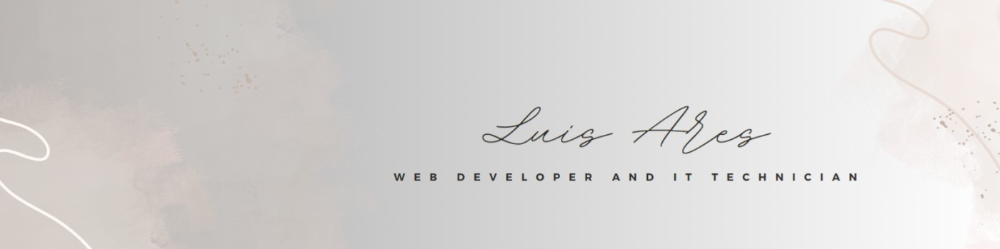

  

<h1 align="center">Luis Ares</h1>

  

  
  
  
  

---

## Sobre mí

Desarrollador Web Full Stack y Técnico Informático con más de una década en el sector IT. Combino el desarrollo de aplicaciones web modernas con la administración de sistemas, lo que me permite llevar un proyecto desde el código hasta el servidor en producción.

- 🔭 Actualmente desarrollo aplicaciones web como **freelance** con React, TypeScript, Django y Node.js
- ☁️ Despliego y administro infraestructura cloud: **OVHcloud, CloudPanel, Plesk, Linux VPS**
- 🛒 Experiencia en **comercio electrónico** e integración de pasarelas de pago y TPV
- 🌱 Ahora mismo profundizando en TypeScript y arquitecturas Full Stack
- 💬 Pregúntame sobre React, WordPress, despliegues en VPS o configuración DNS
- 📫 Disponible para proyectos freelance y nuevas oportunidades

---

## Stack tecnológico

**Frontend**

**Backend**

**Bases de datos**

**CMS, Cloud y Sistemas**

**Herramientas**

---

## Proyectos destacados

| Proyecto | Descripción | Stack |
|---|---|---|
| **[Pollo Kanalla](https://pollo-kanalla.vercel.app/)** | Web corporativa para restaurante, desplegada en Vercel | React · TypeScript |
| **[La Velada del Año VI](https://velada-iv-vert.vercel.app/)** | Propuesta candidata a web oficial del evento de Ibai Llanos en Sevilla: landing con cartelera confirmada, combate principal e información del evento, optimizada para SEO y redes sociales | Landing page · Vercel |
| **Aplicación web (bajo NDA)** | Aplicación web Full Stack con pasarela de pago integrada | React · TypeScript · Django · Node.js |
| **Infraestructura multisitio WordPress** | Despliegue desde cero de un VPS en OVHcloud con CloudPanel y 10 instancias WordPress independientes, optimización Nginx/PHP y DNS avanzado | OVHcloud · CloudPanel · Nginx · WordPress |
| **Rediseño ERP Gesruta** | Rediseño UI/UX de una plataforma de planificación de rutas logísticas | HTML · CSS · JavaScript |

👉 Más proyectos en [mis repositorios](https://github.com/luisaap-dev?tab=repositories)

---

## Experiencia

**Desarrollador Web Freelance** · *Ago 2026 – Actualidad*
Desarrollo Full Stack con React, TypeScript, Django y Node.js, incluida la integración de pasarelas de pago.

**Administrador de Sistemas / Programador Web (Freelance)** · *Jun 2026 – Ago 2026*
Despliegue de servidores cloud en OVHcloud, securización de CloudPanel, 10 sitios WordPress en producción y gestión DNS (A, CNAME, TXT).

**Programador Web / Técnico Informático — FAXPG** · *Ene 2026 – Abr 2026 · A Coruña*
Rediseño de tienda online, pasarelas de pago y TPV, administración de Microsoft 365 y Google Drive, soporte Helpdesk y redes.

**Programador Web — Informática de Empresa ATIE, SL** · *Abr 2024 – Jun 2024 · Fene*
Desarrollo con React, WordPress, PHP y MySQL; publicación en entornos Stratos con Plesk.

**Programador Web — Plus42** · *Sep 2023 · A Coruña*
Rediseño UI/UX del ERP Gesruta.

**Técnico Informático Freelance** · *2012 – 2017 · Fene*
Reparación de hardware y software, soporte remoto y presencial, asesoramiento tecnológico.

---

## Formación

- **Desarrollo de Aplicaciones Web con React** — Cluster TIC Galicia *(2025)*
- **Técnico Superior en Desarrollo de Aplicaciones Web (DAW)** — CFP Afundación *(2024)*
- **Certificado de Profesionalidad IFCD0210** — Desarrollo de Aplicaciones con Tecnología Web *(2023)*
- **Técnico en Sistemas Microinformáticos y Redes (SMR)** — CPIFP Rodolfo Ucha Piñeiro *(2011)*

---

## Estadísticas

  
  

  

---

  ¿Tienes un proyecto en mente? <a href="mailto:luisaap.dev@gmail.com"><b>Escríbeme</b></a> y hablamos.

  

